<p align="center">
  
</p>

<p align="center">
  
</p>

```diff
@@ hello, ls shubham @@
+ ai engineer @ rocketfrog ai // production rag, multi-agent systems, document ai
+ databricks certified data engineer associate
+ harnessing ai
- sleep schedule (deprecated)
```

<p align="center">
  
  
  
  
  
  
  
</p>

<p align="center">
  <a href="https://linkedin.com/in/shubham-dwivedi2403">
    
  </a>
</p>
